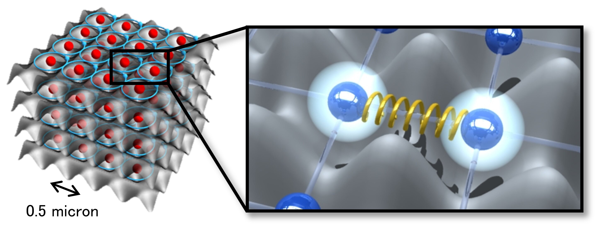

   

# Quantum-Circuit-Simulations

  

---

## 📖 Abstract
This repository is dedicated to building a **general-purpose quantum circuit simulator** that runs on classical hardware (GPU/CPU) but enables users to **experiment with quantum algorithms and quantum matter models**.  

The aim is to provide both **educational insight** and **research-level tools** by simulating:
- **Quantum algorithms**: Grover’s search, Shor’s factoring, variational methods.
- **Quantum matter**: Molecular Hamiltonians (e.g., Hydrogen, Carbon).
- **Topological systems**: Kitaev chains, SSH models, exotic states of matter.
- **Dynamics**: Solving the Schrödinger equation for time evolution.

Ultimately, this project seeks to deliver a **downloadable program** where users can explore quantum mechanics from fundamental particles to advanced algorithms.

---

## 🌌 What Are Quantum Mechanics?
Quantum mechanics is the branch of physics that governs **the smallest scales of nature**: electrons, atoms, and photons. Unlike classical mechanics:
- Particles can exist in **superpositions** (multiple states at once).
- Systems can be **entangled**, meaning their states are correlated no matter the distance.
- Observations **collapse** probabilities into definite outcomes.

These strange but powerful principles underpin quantum computing and the exotic properties of quantum matter.

---

## ⚛️ Quantum Matter
**Quantum matter** refers to materials whose essential properties are dictated by quantum mechanics. Examples:
- **Molecules**: Hydrogen (H₂), Carbon, etc.  
- **Correlated systems**: superconductors, magnets.  
- **Exotic phases**: states that cannot be explained without quantum entanglement.

By mapping electronic structures to qubits, we can simulate the **Hamiltonian** (the energy operator) of molecules and predict their properties.

---

## 🌀 Topological Matter
Topological matter refers to materials whose properties are defined not by local details, but by **global topological invariants**.  

Examples:
- **Topological insulators**: conduct on the surface, insulate inside.
- **Kitaev chain**: supports exotic **Majorana zero modes**.
- **Su-Schrieffer-Heeger (SSH) model**: illustrates edge states and symmetry protection.

These systems are not just theoretical curiosities — they are leading candidates for **fault-tolerant quantum computation**.

---

## 🔑 Quantum Algorithms

### 🔍 Grover’s Algorithm
- **Purpose**: Speed up searching an unsorted database from O(N) to O(√N).  
- **Why it matters**: Demonstrates quadratic speedup and amplitude amplification.  
- **Simulation goal**: Implement an oracle, run amplitude amplification, and visualize the probability distribution.

---

### 🔐 Shor’s Algorithm
- **Purpose**: Factorize large integers exponentially faster than classical algorithms.  
- **Why it matters**: Breaks RSA encryption and illustrates quantum advantage.  
- **Simulation goal**: Factor small integers (15, 21, 35) and visualize quantum Fourier transform (QFT).

---

### 📜 Schrödinger Equation
- **Equation**:  
  \[
  i\hbar \frac{\partial}{\partial t}\Psi(x,t) = \hat{H}\Psi(x,t)
  \]
- **Purpose**: Governs all quantum evolution.  
- **Why it matters**: It’s the foundation of quantum mechanics — describes how wavefunctions change over time.  
- **Simulation goal**: Implement numerical solvers for time evolution of wavefunctions and circuits.

---

### 🏗️ Topological Matter Algorithms
- **Purpose**: Simulate exotic condensed matter models (Kitaev, SSH).  
- **Why it matters**: Understand protected quantum states and potential platforms for **topological qubits**.  
- **Simulation goal**: Compute band structures, topological invariants, and simulate edge states.

---

## 🎯 Project Goals

### Phase 1 — Quantum Matter
- Create a **program** where users can simulate simple molecules like **Hydrogen (H₂)** at the atomic level.  
- Use tools like **OpenFermion + PySCF** to generate Hamiltonians and map them to qubits.  
- Provide a **VQE (Variational Quantum Eigensolver)** example to compute ground-state energies.

---

### Phase 2 — Algorithms
- Implement **Grover’s algorithm** (search).  
- Implement **Shor’s algorithm** (factoring).  
- Provide visualization tools to understand the circuits.

---

### Phase 3 — Dynamics
- Implement **time-dependent Schrödinger equation solvers**.  
- Allow users to simulate **wave packet evolution** and **Hamiltonian dynamics**.

---

### Phase 4 — Topological Models
- Add simulations for **Kitaev chains** and **SSH models**.  
- Provide visualization of band structures, edge states, and Majorana modes.

---

## 🛠️ Planned Features
- Easy **installation** and **cross-platform binaries**.
- Support for **NVIDIA GPU acceleration** (CUDA/cuQuantum).  
- **Interactive CLI** and **graphical visualization tools**.  
- Preloaded **example datasets** (H₂, Grover, Shor, SSH).  
- Modular **Python API** for researchers.  

---

